# Postbox

A self-hosted, lightweight, open-source alternative to Postman. Run it as a Docker web app on your LAN,
or use the portable Windows edition for a local, zero-install app. Requests, scripts and collection runs
execute on the machine running Postbox, so VPN-connected Windows users can reach services from their PC.

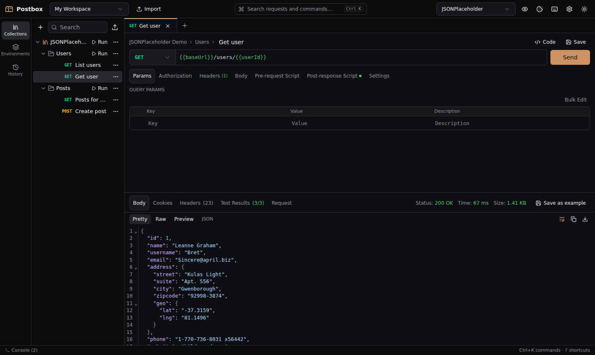

<table>
  <tr>
    <td width="50%">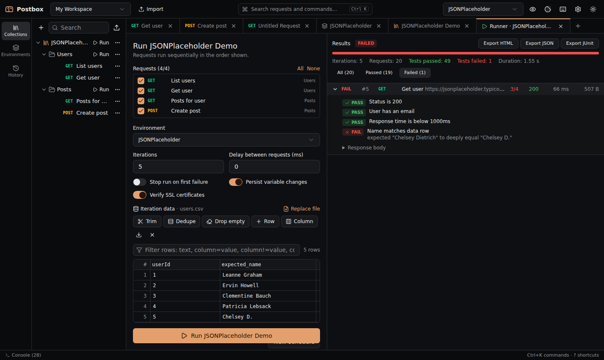</td>
    <td width="50%">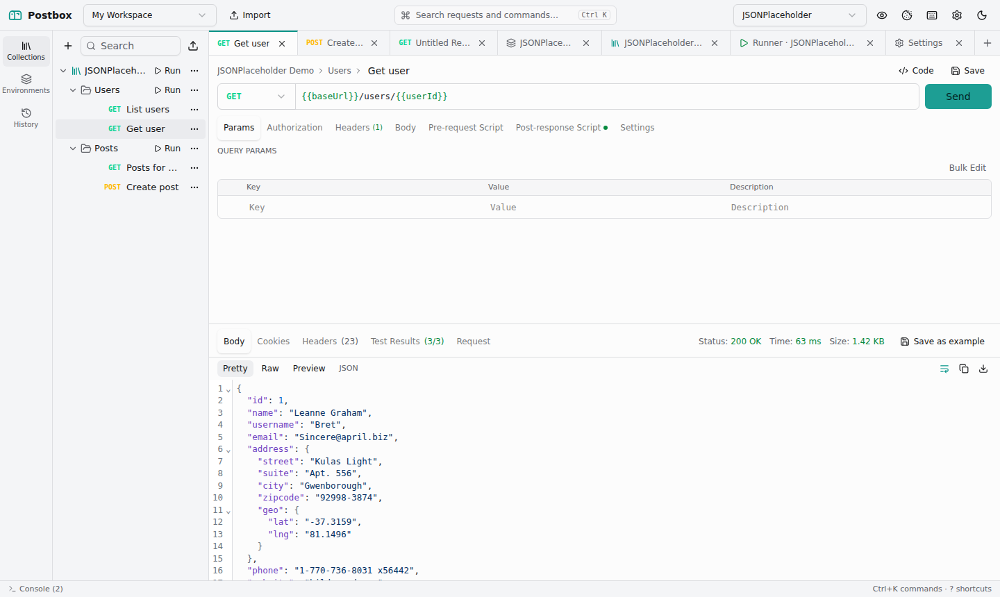</td>
  </tr>
  <tr>
    <td align="center"><sub>Data-driven collection runs</sub></td>
    <td align="center"><sub>Light theme and any accent color</sub></td>
  </tr>
</table>

## Contents

- [Features](#features)
- [Quick start (Docker)](#quick-start-docker)
- [Portable Windows edition](#portable-windows-edition)
- [Usage guide](#usage-guide)
  1. [Send your first request](#1-send-your-first-request)
  2. [Collections, folders and inheritance](#2-collections-folders-and-inheritance)
  3. [Environments and variables](#3-environments-and-variables)
  4. [Scripts and tests](#4-scripts-and-tests)
  5. [Run a collection with iteration data](#5-run-a-collection-with-iteration-data)
  6. [Import, export and code snippets](#6-import-export-and-code-snippets)
  7. [Command palette and keyboard shortcuts](#7-command-palette-and-keyboard-shortcuts)
  8. [Customize Postbox](#8-customize-postbox)
  9. [Command-line runner](#9-command-line-runner)
  10. [Connect Claude Code and other MCP clients](#mcp-server-apimcp)
- [Development](#development)
- [Configuration](#configuration)
- [Running behind a reverse proxy](#running-behind-a-reverse-proxy)
- [Roadmap](#roadmap)

## Features

- **Request builder**: every method; params, headers and body (raw JSON/XML/text/HTML/JS, form-data with file upload,
  urlencoded, binary, GraphQL); auth (Bearer, Basic, API key, Digest, NTLMv2, OAuth 1.0 (HMAC/RSA/PLAINTEXT in header, query or body),
  OAuth 2.0 client-credentials/password/authorization code with PKCE (browser sign-in)/manual, Hawk, Akamai EdgeGrid,
  AWS Signature V4 with session tokens, header or presigned-URL mode, and re-signing on same-origin redirects,
  Atlassian ASAP JWTs signed with RS/PS/ES keys);
  per-request settings (timeout, redirects, SSL verify, cookie jar). Multi-tab editing with unsaved-draft persistence.
- **WebSockets**: enter a `ws://` or `wss://` URL and **Connect** to open a live session with the request's headers and
  auth. Send text or base64 binary frames, see a timestamped log of both directions, then disconnect or reconnect.
  Secrets are redacted and host policy applies. Automation: `POST /api/ws` (NDJSON events), `/api/ws/{id}/send` and `/api/ws/{id}/close`.
- **Socket.IO**: turn on **Socket.IO connection** in a request's Settings (namespace, path, ack timeout), then **Connect**.
  Emit named events with JSON arguments, optionally waiting for an acknowledgement (timeouts are reported). Saved
  listeners filter incoming events. Works with Socket.IO v3/v4 servers over WebSocket. Automation: `POST /api/socketio`,
  `/api/socketio/{id}/emit` and `/api/socketio/{id}/close`.
- **MQTT**: enter an `mqtt://` or `mqtts://` broker URL and **Connect** (Basic auth supplies the username and password).
  Subscriptions (topic filters with QoS) and the connection profile (client ID, MQTT 3.1.1/5, clean session,
  keepalive) are saved on the request. Publish text or binary with QoS and retain, and see a timestamped history.
  Automation: `POST /api/mqtt`, then `/api/mqtt/{id}/publish`, `/subscribe`, `/unsubscribe` and `/close`.
- **gRPC**: enter a `grpc://` or `grpcs://` URL, add `.proto` files or use server reflection, pick a method and **Invoke**
  (unary and all three streaming kinds, with interactive sends).
  Definitions come from supplied `.proto` files or server reflection.
  Automation: `POST /api/grpc`, `/api/grpc/describe` and `/api/grpc/reflect`; see [docs/grpc.md](docs/grpc.md).
- **Server-sent events**: **Stream** opens the request as an event stream and shows events live (event, id, data),
  reconnecting with `Last-Event-ID` and the server's `retry` delay. Variables, auth, inherited headers and host policy
  apply; scripts do not run. Up to 1000 events by default; secrets are redacted. Also available as `POST /api/sse` (NDJSON).
- **Collections**: nested folders, drag & drop, rename, duplicate, search. Auth, headers and scripts set on a collection or folder are inherited by everything inside.
- **Scripts**: sandboxed (QuickJS/WASM, with memory and time limits) Postman-compatible `pm.*` API: variables, `pm.request`,
  `pm.response`, `pm.test`, `pm.expect` (chai-style), `pm.sendRequest`, `setNextRequest`. Includes a console panel.
- **Variables**: global, collection, environment, iteration-data and local scopes, with Postman precedence. Supports `{{var}}` highlighting
  and autocomplete, dynamic variables (`{{$guid}}`, `{{$timestamp}}`, `{{$randomInt}}`, …) and masked secrets.
- **Collection runner**: CSV/JSON/XLSX iteration data with an editable grid (edit cells, delete rows/columns, trim,
  dedupe, filter). Options for iterations, delay and stop-on-failure. Live results, export to JSON, JUnit and HTML.
  Runs can also be scheduled with cron expressions.
- **Response viewer**: status, timing breakdown (DNS/TCP/TLS/TTFB/download), size, headers, cookies; Pretty/Raw/Preview with folding and search;
  test results; save as example.
- **Import/export**: Postman v2.0/v2.1 collections and environments, OpenAPI 3 and Swagger 2 (from a file, pasted text or a URL), and cURL
  (paste one into the URL bar). Code snippets for cURL, fetch, Python and PowerShell.
- **Settings**: a searchable Settings page for theme, accent color, fonts, density, layout, editor behaviour and
  defaults for new requests, responses, tabs, the console and the runner. Administrators also set instance-wide
  **Request execution** defaults: headers added to every request, the User-Agent, automatic `Accept` headers and
  script time and memory limits.
- **MCP server (`/api/mcp`)**: Streamable HTTP Model Context Protocol endpoint so Claude Code, Open WebUI, Cursor and other MCP clients can inspect workspaces, create/edit collections, folders, environments and requests, execute single requests, run collections with iteration data, and import/export specs.
- **Command-line runner**: `postbox-cli run` runs Postman collections headlessly with the same engine (Newman-style).
- History, cookie manager, command palette (Ctrl+K) and keyboard shortcuts (press `?` in the app).

## Quick start (Docker)

```bash
git clone https://github.com/nkskater/postbox.git
cd postbox
cp .env.example .env && chmod 600 .env   # set POSTBOX_PASSWORD / POSTBOX_TOKEN here
docker compose up -d --build
# open http://<server-ip>:3000
```

Data lives in the `postbox-data` volume (`/data/postbox.db`). To use a bind mount instead, replace the volume with
`./data:/data` and make the directory writable by UID 1001.

## Portable Windows edition

The portable x64 bundle runs on Windows 10/11 without an installer or administrator rights. Download
`Postbox-windows-x64.zip` from the [latest GitHub release](https://github.com/nkskater/postbox/releases/latest),
extract it, and double-click **Postbox.cmd**. Postbox opens in your browser at `http://127.0.0.1:47392/`;
keep the console window open while using it. If that port is unavailable, Postbox selects another free local port.
It binds only to loopback, so it does not expose the app to your network or require a Windows Firewall rule.

The bundle includes its Node.js runtime and SQLite native module. By default, the `Data` folder beside
`Postbox.cmd` stores the database and daily backups. Keep this folder when updating: replace the `app` and
`runtime` folders and launcher files from the new zip, leaving `Data` in place. For a data directory outside
the extracted bundle, create `Settings.cmd` beside `Postbox.cmd`, for example:

```bat
set "DATA_DIR=%LOCALAPPDATA%\Postbox"
set BACKUP_KEEP=30
```

`Settings.cmd` can also set `DATABASE_PATH`, `PORT`, `NO_BROWSER=1`, `POSTBOX_PASSWORD`, and `POSTBOX_TOKEN`.
The launchers use the Windows system certificate store for HTTPS, which can help when accessing services through
a corporate VPN. Requests originate from the Windows PC, using its active network and VPN connection.

Use **Postbox CLI.cmd** to run a collection from Command Prompt or PowerShell, for example:

```bat
"Postbox CLI.cmd" run collection.json -e environment.json --bail
```

Run **Create desktop shortcut.cmd** to add shortcuts to the Desktop and Start menu. For screenshots and more
details, see the [Windows edition guide](windows/READ%20ME.txt). Developers can build the bundle on a supported
build host with `npm run build:windows`; this writes `dist/Postbox-windows-x64.zip`. The hosted Windows package
workflow also attaches the zip to tagged GitHub releases.

> **Try the demo.** Everything in the guide below uses the files in [`docs/demo/`](docs/demo): a collection for the
> free [JSONPlaceholder](https://jsonplaceholder.typicode.com) API, a matching environment and a CSV of test data.
> Import the collection and environment with **Import → File**, then pick **JSONPlaceholder** in the environment
> selector at the top right.

## Usage guide

### 1. Send your first request

1. Press **Alt+T** (or the **+** next to your tabs) to open a new request.
2. Pick a method and type a URL. Query parameters typed in the URL appear in the **Params** tab, and edits there update the URL.
3. Add **Headers**, an **Authorization** method and a **Body** if you need them. For JSON, choose **Body → raw → JSON**;
   **Beautify** formats it.
4. Press **Send** (or **Ctrl+Enter**). Save the request into a collection with **Ctrl+S**.

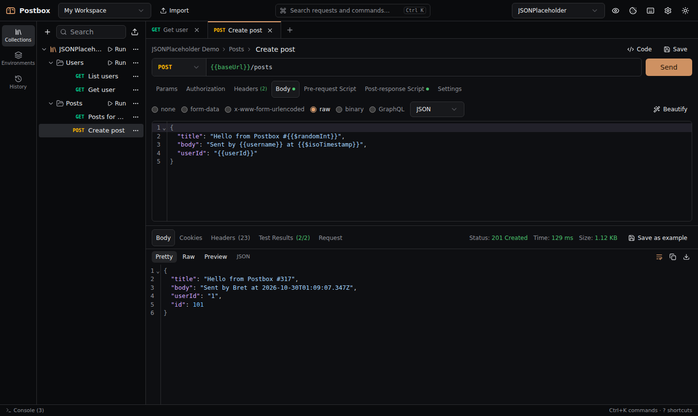

The response panel shows the status, time and size. Click **Time** for a breakdown of where the time went (DNS,
TCP, TLS, waiting for the first byte, download). Click **Size** to see header and body sizes. **Pretty** formats JSON and XML
with folding; press **Ctrl+F** inside the body to search. **Preview** renders HTML, images and PDFs. **Save as example**
stores the response with the request.

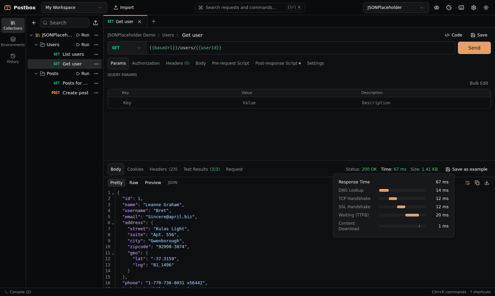

The **Request** tab in the response panel shows exactly what was sent after variables, inherited headers and auth were applied.
Secret values are redacted.

### 2. Collections, folders and inheritance

Collections group requests into folders. Create one with **+** in the sidebar or import one. Each row has a **Run**
button and a **⋯** menu (add request or folder, rename, duplicate, export, delete). Drag rows to reorder them or move them
between folders.

**Edit collection** (or **Edit folder**) opens settings that everything inside inherits:

- **Authorization**: requests set to *Inherit auth from parent* use the nearest folder's or the collection's auth.
- **Headers**: added to every request inside, unless the request sets a header with the same name.
- **Pre-request / Post-response scripts**: run before or after every request inside, outermost first.
- **Variables** (collections only): collection variables.

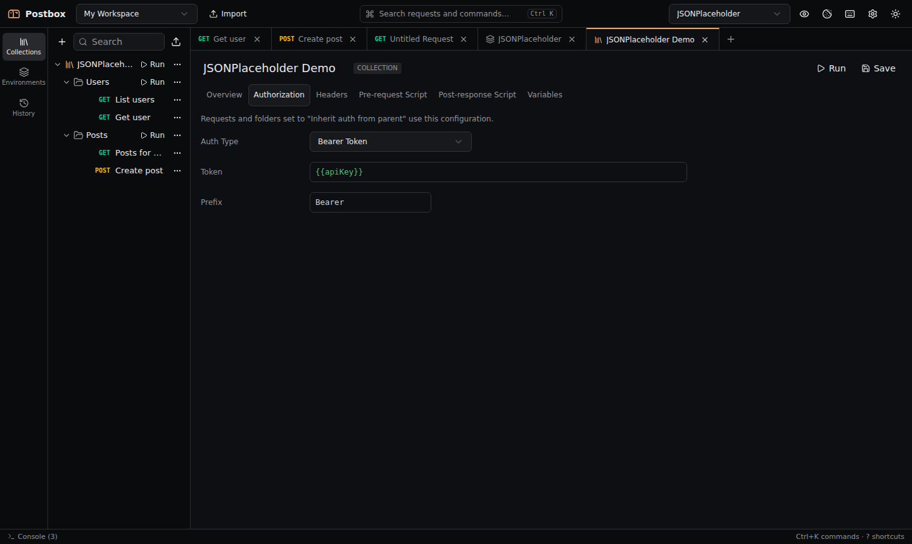

### 3. Environments and variables

Use `{{name}}` anywhere: URL, params, headers, body, auth fields and scripts. Postbox highlights variables as you
type: **green** when defined and **red** when not. Hover over one to see its current value and where it comes from.
Type `{{` to get autocomplete.

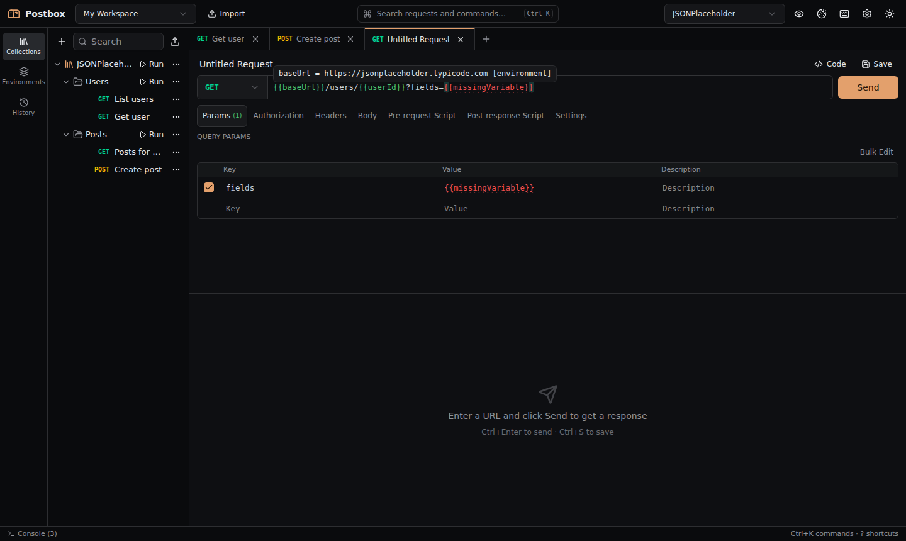

Variables come from these scopes, highest priority first:

| Scope | Where to edit it |
|---|---|
| Local | `pm.variables.set()` in scripts (lasts one request or one runner iteration) |
| Iteration data | A row of the runner's CSV/JSON/XLSX file |
| Environment | **Environments** in the sidebar; choose the active one at the top right |
| Collection | **Edit collection → Variables** |
| Global | **Environments → Globals** |

Mark sensitive values as **secret**. They are masked in the UI (use the eye button to reveal one) and
redacted from logs, history and the **Request** tab. The 👁 button in the top bar shows every variable in scope.

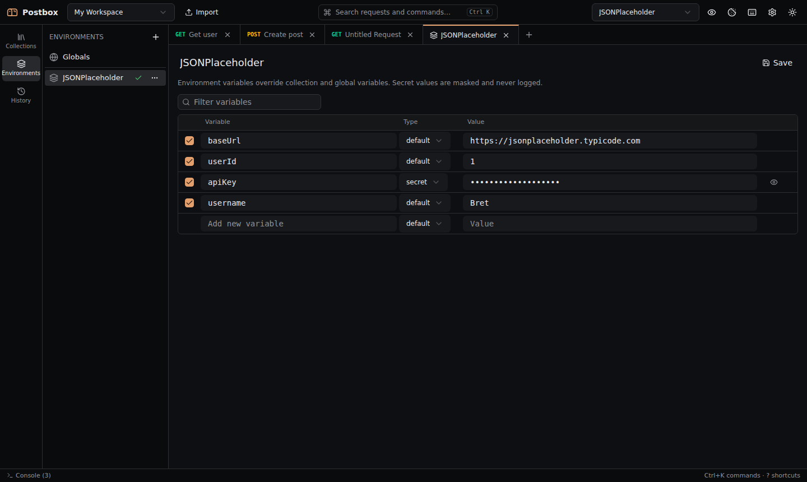

Dynamic variables produce a new value on each use: `{{$guid}}`, `{{$timestamp}}`, `{{$isoTimestamp}}`,
`{{$randomInt}}`, `{{$randomEmail}}`, `{{$randomFirstName}}` and more.

### 4. Scripts and tests

**Pre-request Script** runs before the request is sent and can change it or set variables. **Post-response Script** runs
afterwards with access to `pm.response`. The Postman `pm.*` API is supported, including `pm.test`, chai-style
`pm.expect`, `pm.sendRequest`, `pm.environment` / `pm.collectionVariables` / `pm.globals` / `pm.variables`,
`pm.iterationData` and `pm.execution.setNextRequest`. Click a **snippet** on the right to insert common code.

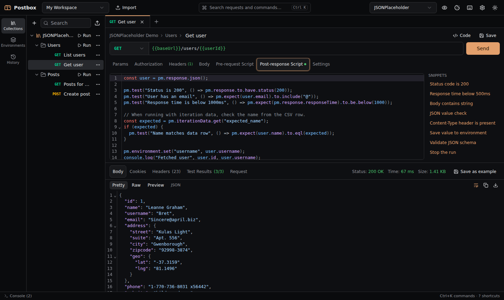

Results appear in the response panel's **Test Results** tab. `console.log()` output appears in the **Console**
(**Ctrl+`**), together with a log line for every request sent.

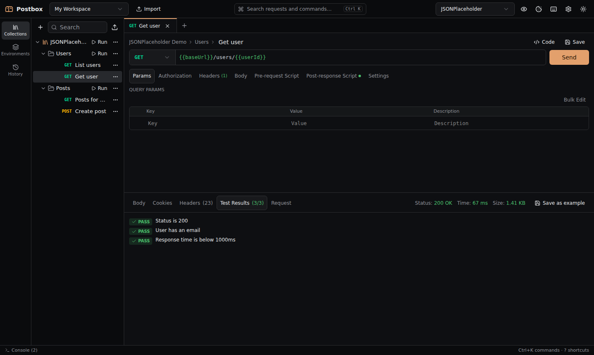

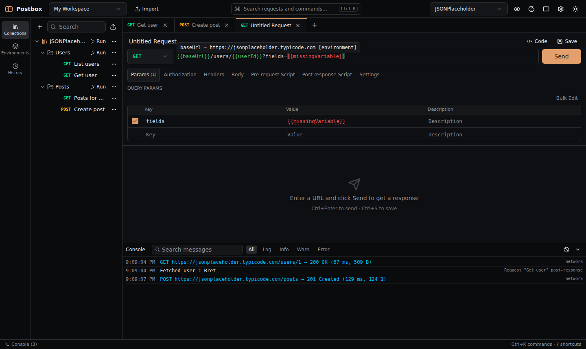

Scripts run in an isolated sandbox with no access to the server's files or network, except through `pm.sendRequest`.
They have time and memory limits, set under Settings → Request execution (default 5 s and 32 MB). Setting
`SCRIPT_TIMEOUT_MS` or `SCRIPT_MEMORY_MB` pins the value; out-of-range values are clamped to 60 s and 512 MB.

Collection runs from the UI, REST API, MCP and schedules share one admission queue: at most
**Concurrent collection runs** execute at once and up to **Queued collection runs** wait in order (shown as
"Queued #N" in the Runner, where Stop removes them). When the queue is full new runs are
rejected with HTTP 429 and scheduled ticks are skipped. The queue is per server process.

### 5. Run a collection with iteration data

Click **Run** on a collection or folder to open the runner. Choose which requests to include, the environment,
iterations, delay and whether to stop on the first failure.

To run the same requests for many inputs, add **Iteration data** (CSV, JSON or XLSX). Each row is one iteration,
and each column becomes a variable for that iteration: a column `userId` is available as `{{userId}}` and
`pm.iterationData.get("userId")`. CSV files are checked on load: a row with more fields than the header,
malformed quotes, or duplicate or missing headers over data are rejected with the row and column at fault, so no
value is silently dropped. Short rows are padded with empty cells and reported as a warning. The CLI and MCP server
apply the same checks. Before running, you can clean the data in the grid:

- edit cells, add or delete rows and columns, and double-click a header to rename it;
- **Trim** whitespace, **Dedupe** rows, **Drop empty** rows;
- **Filter** with free text or `column=value`, `column!=value`, `column~=part`. Only matching rows are run.

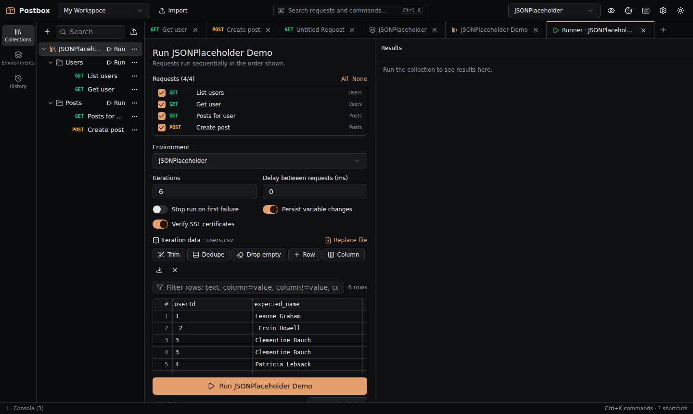

Results stream in live. Filter by **passed** or **failed** and expand a row to see each assertion and the response body.
Save iteration data in the **Datasets** sidebar to reuse it across runs and schedules,
with immutable versions, variable previews and explicit secret columns. See the
[saved datasets guide](docs/saved-datasets.md) for UI, REST and MCP usage.

Export a report as **HTML**, **JSON** or **JUnit XML** (for CI dashboards). Past runs are listed in the runner, and
**Schedules** run a collection on a cron schedule. In the demo, the last CSV row deliberately has the wrong name, so one
assertion fails:


### 6. Import, export and code snippets

**Import** (top bar or sidebar) accepts Postman v2.0/v2.1 collections and environments, OpenAPI 3 / Swagger 2 (JSON or
YAML) from a file, pasted text or a URL. It also accepts **cURL** commands. You can also paste a cURL command straight into a request's URL bar.

Migrations from other clients are also detected: HAR recordings, Hoppscotch, Thunder Client and **Insomnia** (v4 JSON/YAML
exports and v5 collection YAML). For Insomnia, the base environment becomes collection variables and each
sub-environment becomes an environment; folder environments become folder pre-request scripts. Template tags such as
`` are left as text, scripts are imported commented out, and file bodies must be reselected. Every skipped
item is listed in the import warnings. These exports contain credentials, so **Include credentials** must be ticked.

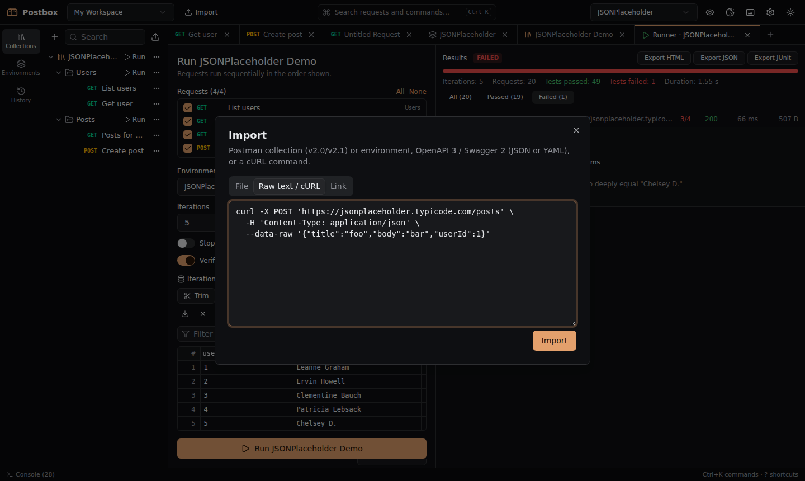

Export a collection from its **⋯** menu (Postman v2.1) and an environment from the Environments list. Secret values are
left out of exports. **Code** next to **Save** generates the request as cURL, JavaScript `fetch`, Python `requests` or
PowerShell, with variables resolved or left as `{{placeholders}}`.

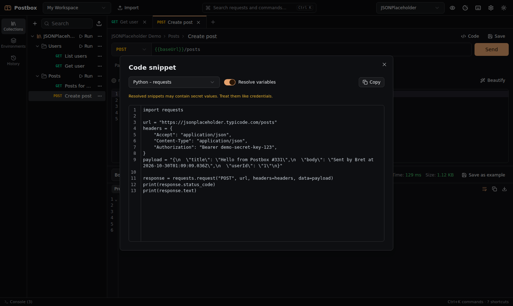

### 7. Command palette and keyboard shortcuts

**Ctrl+K** opens the command palette. Search requests, collections and environments, start a run, or jump to any setting.

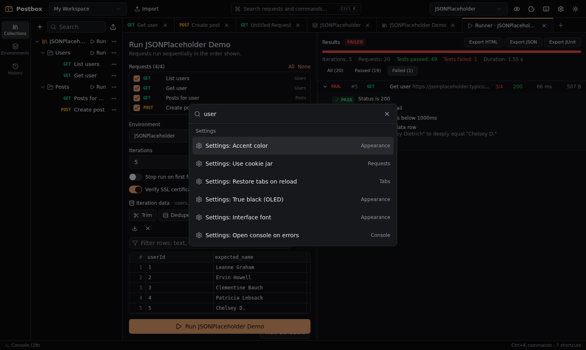

| Shortcut | Action |
|---|---|
| Ctrl/⌘ + Enter | Send request |
| Ctrl/⌘ + S | Save request / folder / environment |
| Ctrl/⌘ + K | Command palette |
| Ctrl/⌘ + , | Settings |
| Ctrl/⌘ + B | Toggle sidebar |
| Ctrl/⌘ + ` | Toggle console |
| Alt + T / Alt + W | New tab / close tab |
| Alt + 1…9 | Jump to tab |
| Ctrl/⌘ + F | Search inside an editor or response |
| ? | Show all shortcuts |

### 8. Customize Postbox

Open **Settings** with the gear icon or **Ctrl+,**. Settings are saved on the server, so they follow you to every
browser on your network. Use the search box to find any setting. Changed settings show a dot and can be reset the
individually, per section, or all at once. You can also export your settings to a file and import them elsewhere.

- **Appearance**: dark, light or system theme; accent color (presets or any custom color); background tone; true-black
  mode; interface font and size; density; corner radius; reduce motion.
- **Layout**: sidebar on the left or right, rail labels, request and response stacked or side by side.
- **Editor**: code font, size and line height, line numbers, folding, wrapping, tab size, bracket matching, variable autocomplete.
- **Requests / Responses / Tabs / Variables / Console / Collection runner**: defaults for new requests (method,
  timeout, redirects, SSL, cookies), response view and large-body threshold, preview tabs, confirmation before closing unsaved tabs,
  secret display, console limits, and runner options.
- **History & data** (administrators): how many history entries to keep per workspace (`HISTORY_LIMIT` still overrides it),
  how many days to keep them, and whether to skip history for requests that use secrets. This section also shows the database
  file and size, compacts it, clears history, cookies or run results, and makes or restores a full backup. See
  [docs/backup-and-data.md](docs/backup-and-data.md).
- **Server (environment)** shows read-only settings that come from environment variables (see [Configuration](#configuration)).

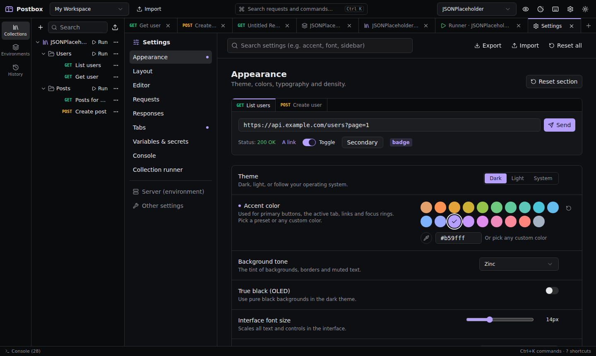

### 9. Command-line runner

The Docker image includes `postbox-cli`, a Newman-style runner that uses the same engine without a server or database:

```bash
docker compose run --rm -v "$PWD/docs/demo:/work" postbox \
  postbox-cli run /work/jsonplaceholder.postman_collection.json \
    -e /work/jsonplaceholder.postman_environment.json \
    -d /work/users.csv \
    --reporters cli,junit --reporter-junit-export /work/report.xml
```

Options include `-g` (globals), `-n` (iterations), `--delay`, `--bail`, `--insecure`, `--timeout` and the
`json`, `junit` and `html` reporters. The CLI does not read server settings; pass request defaults as flags:
`-H "Name: value"` (repeatable default header), `--user-agent <value>` (`""` sends none), `--no-accept-headers`,
`--script-timeout <ms>` and `--script-memory <mb>`. The exit code is non-zero when a request or assertion fails, so it can be used in CI.

## Development

```bash
npm install
npm run dev        # http://localhost:3000, DB at ./data/postbox.db
npm test           # Vitest suites for the engine, sandbox, runner, converters, repository, settings and MCP
npm run lint && npm run typecheck
npm run db:generate  # after changing src/server/db/schema.ts
```

### Regenerating the screenshots

The images in `docs/screenshots/` are produced by `scripts/screenshots.mjs`, which imports the demo files from
`docs/demo/` into a fresh database and captures each screen with Playwright:

```bash
DATABASE_PATH=/tmp/postbox-shots.db npm run dev   # in one terminal (use a new, empty database)
npm run screenshots                               # in another; needs network access for the demo API
```

Set `BASE_URL` if the app is not on `http://localhost:3000`, and `CHROMIUM_PATH` to use a specific Chrome or
Chromium binary (otherwise run `npx playwright-core install chromium` once).

## Configuration

| Variable | Default | Description |
|---|---|---|
| `DATABASE_PATH` | `/data/postbox.db` (prod), `./data/postbox.db` (dev) | SQLite file |
| `PORT` | `3000` | HTTP port |
| `POSTBOX_PASSWORD` | _(none)_ | Enables login with this password |
| `POSTBOX_TOKEN` | _(none)_ | Enables `Authorization: Bearer` access (API, MCP, automation) |
| `POSTBOX_SESSION_SECRET` | _(generated)_ | Optional explicit key for signing session cookies (otherwise derived from the env credentials, or generated and stored for accounts) |
| `POSTBOX_SESSION_DAYS` | `30` | Session lifetime |
| `PROXY_ALLOW_HOSTS` | _(all)_ | Comma list of hosts, `*.wildcards` or CIDRs requests may target |
| `PROXY_DENY_HOSTS` | _(none)_ | Comma list that is always blocked (wins over allow) |
| `PROXY_ALLOW_SOCKETS` | _(none)_ | Unix sockets / named pipes requests may connect to; everything else is denied |
| `SCRIPT_TIMEOUT_MS` | _(setting)_ | Pins the script time limit (100–60000 ms; otherwise set in Settings) |
| `SCRIPT_MEMORY_MB` | _(setting)_ | Pins the script memory limit (8–512 MB; otherwise set in Settings) |
| `RUNS_MAX_ACTIVE` | _(setting)_ | Pins how many collection runs execute at once (1–32, default 4) |
| `RUNS_MAX_QUEUED` | _(setting)_ | Pins how many runs may wait for a slot (0–500, default 20); further runs get HTTP 429 |
| `RESPONSE_MAX_BYTES` | `52428800` | Encoded response bytes are truncated at this limit; decompression exceeding the limit at any stage is rejected |
| `API_BODY_LIMIT_MB` | `25` | Largest JSON body the REST API and `/api/mcp` accept (file uploads travel inline as base64); larger bodies get `413` |
| `MCP_ALLOWED_ORIGINS` | _(none)_ | Extra browser origins allowed to call `/api/mcp` (cross-origin browser requests are rejected otherwise) |
| `HISTORY_LIMIT` | `500` | History entries kept per workspace |

### Outbound host policy and redirects

`PROXY_ALLOW_HOSTS` and `PROXY_DENY_HOSTS` accept comma-separated ASCII hostnames
(use punycode for international names), `*.example.com` subdomain patterns, IPv4/IPv6
addresses, CIDRs, or `*`. Wildcards exclude the apex. Names ignore case and a trailing
DNS dot. An empty setting disables that list; malformed entries, empty comma-separated
entries, URLs, ports and invalid CIDR prefixes reject the policy when it is loaded.
Deny rules win, and hostnames and resolved addresses are checked at every redirect hop.

### Unix domain sockets and named pipes

A request can connect to a local Unix socket or Windows named pipe instead of TCP: set the
**Unix socket or named pipe** in the request's Settings tab (or `settings.socketPath` through the API/MCP; variables
work). The URL still provides the path, query and `Host` header, e.g. `http://localhost/v1/status`,
and auth, scripts and collection runs work as usual. Sockets are denied unless listed in
`PROXY_ALLOW_SOCKETS`: exact absolute paths, `/dir/*` for sockets directly inside a directory, or
`\\.\pipe\name`. Symlinks are resolved first, so a link cannot point at an unlisted socket such as
the Docker daemon's. When mounting a socket into the container, mount only the one you list. A
redirect to another origin leaves the socket and uses normal host policy. The CLI accepts
`--allow-socket <path>` (repeatable). Generated code snippets do not include the socket.

HTTPS-to-HTTP redirects are rejected with `EREDIRECTDOWNGRADE`, even with SSL verification
disabled. Disable redirect following to inspect the original redirect response.
Same-origin redirects retain request headers. Across origins (including a port change),
only `Accept`, `Accept-Encoding`, `Accept-Language`, `Content-Type`, `Content-Length`, and
`User-Agent` are forwarded. All other headers, including custom API keys, authorization,
explicit cookies, proxy authorization and referrers, are removed and stay removed on later
hops. Host is regenerated for the destination; applicable destination cookies are loaded
from the cookie jar. Digest credentials are never reused across origins. Normal redirect
method/body rules still apply; 307/308 preserve the body, so use trusted redirect targets
and the host policy for requests carrying sensitive bodies.

### Container resource limits

Docker Compose limits the entire running app, including the web server, request execution,
script sandboxes and collection runs. Set these Compose variables in `.env`:

| Variable | Default | Description |
|---|---|---|
| `POSTBOX_MEMORY_LIMIT` | `1g` | Total container memory, using Docker byte units such as `512m` or `2g` |
| `POSTBOX_CPU_LIMIT` | `2.0` | CPU quota in cores; fractional values such as `0.5` are supported |
| `POSTBOX_PIDS_LIMIT` | `256` | Maximum total processes and threads in the container |

These [Compose service limits](https://docs.docker.com/reference/compose-file/services/)
apply at runtime, including `docker compose run postbox postbox-cli ...`; they do not limit image builds
or `npm run dev` on the host. `SCRIPT_MEMORY_MB` and `SCRIPT_TIMEOUT_MS` still limit each script separately.
The container budget also covers Node.js, QuickJS/WASM overhead, response bodies and concurrent runs,
so keep it above the per-script allowance and increase it for large responses or many simultaneous runs.
Reaching the memory limit can cause Docker to kill the app; reaching the CPU quota throttles it.
The PID limit includes Node.js worker threads, so setting it too low can prevent startup or scripts from running.

After editing `.env`, apply the limits with `docker compose up -d`. Check the resolved configuration with
`docker compose config --quiet` and inspect runtime use with `docker stats postbox`.

### Authentication

Postbox is open until you turn on one of the options below. Once auth is on, the UI and every API route, including
`/api/mcp`, require it. `/api/health`, `/login` and `/api/auth/*` stay public.

**User accounts (recommended).** Open **Profile** (the person icon in the top bar) and create the administrator
account. From then on everyone signs in with a username and password, and each person creates their own API tokens
under Profile for the CLI, scripts and MCP clients (`Authorization: Bearer pbx_…`). Tokens are shown once, can expire,
and can be revoked at any time. Changing your password signs out your other sessions. In open mode, whoever reaches
Profile first can create the administrator, so do this before exposing Postbox. To control that step, set the
`POSTBOX_PASSWORD` or `POSTBOX_TOKEN` first: the first account can then only be created after signing in with them.
Each account receives a private workspace. Existing workspaces are assigned to the first administrator.
Under **Settings → Workspace sharing**, owners can add existing accounts and assign viewer, editor or owner
roles. Viewers can read/export; editors can also modify and execute requests; owners can manage membership and
delete the workspace. Administrators can access every workspace. Hidden workspaces return 404; actions disallowed
by a visible workspace's role return 403. REST and MCP enforce the same roles, including history, cookies and exports.
Scheduled runs use their creator's identity and stop when that account is disabled or loses execution access.
See [Users and sharing](#users-and-sharing) for user administration and invite links.

**Single-user mode.** Without accounts, these environment variables work as before:

- `POSTBOX_PASSWORD`: enables the `/login` page, which issues a signed, HTTP-only session cookie (default 30 days).
  Once an account exists, the password login is replaced by username and password, and old password sessions end.
- `POSTBOX_TOKEN`: accepted as `Authorization: Bearer <token>`. It keeps working after accounts exist, as an
  administrator recovery login, so keep it secret or unset it.

Put them in the git-ignored `.env` file (see `.env.example`), not in `docker-compose.yml`, which is tracked in git.
Anyone with Docker access on the host can still read them with `docker inspect`. Changing either value signs out
single-user sessions; account sessions are signed with `POSTBOX_SESSION_SECRET` or a key Postbox generates and keeps in
its database. Failed logins are rate limited per client address and per account. Only run Postbox without auth on a
trusted network.

### Users and sharing

Administrators open **Settings → Users** to create accounts, disable or enable users, reset passwords,
promote or demote administrators, and revoke a user's sessions and API tokens. Password changes and account
management invalidate existing sessions. The last active administrator cannot be disabled or demoted.
Accounts are disabled rather than deleted, preserving history and run attribution.

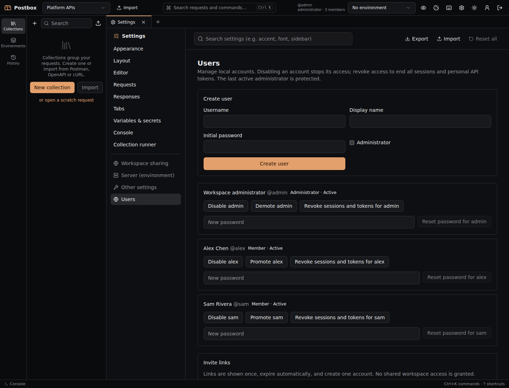

Owners open **Settings → Workspace sharing** to add existing users and assign viewer, editor or owner roles.
Viewers read and export; editors also edit and execute; owners manage sharing and delete the workspace.
Administrators have access to every workspace. The top bar shows your signed-in account and effective workspace
role; MCP clients can inspect their identity and accessible roles with `whoami`.

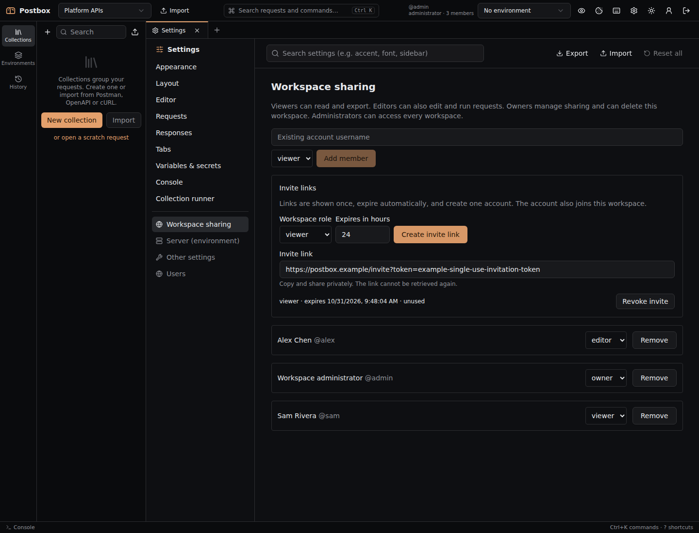

Administrators can create account-only invite links from Users. Workspace owners can create invites that also
grant access to their workspace. Copy a newly created link and share it privately: it is displayed once,
expires after 24 hours by default (configurable from 1 to 168 hours), and can create exactly one account.
The database stores only its hash. Links can be revoked, and accepting rechecks the inviter's current permission.
Every new account receives its own private workspace. Invites never grant instance administrator privileges.

All settings marked **browser** in the registry—including appearance, layout, editors, request/response/tab,
variable display, console and runner defaults—are private to the signed-in account, including imports, exports
and resets. Settings marked **server** are instance-wide and only administrators may change them; environment
variables still override them. On upgrade, legacy shared browser preferences move to the first active
administrator; other accounts start with defaults. Open/single-user installations retain their existing shared
preferences until the initial administrator is created. Collection configuration, environment variables and
workspace history remain workspace data and follow membership roles.

Regenerate these two screenshots against a fresh throwaway instance (no external target requests):

```bash
DATABASE_PATH=/tmp/postbox-users-demo.db npm run dev -- --port 3124
# In another terminal, with Chromium installed:
SCREENSHOT_SET=users BASE_URL=http://localhost:3124 npm run screenshots
```

## Running behind a reverse proxy

Postbox is a single HTTP service. Collection runs stream progress as NDJSON, so turn off response buffering.

Runs continue saving results if the browser disconnects. A progress subscriber whose
queued events exceed 1 MiB is disconnected so a slow connection cannot accumulate
unbounded server memory. Reopen the run from history to inspect its persisted results.

**Caddy**
```
postbox.example.com {
    reverse_proxy postbox:3000 {
        flush_interval -1
    }
}
```

**nginx**
```nginx
location / {
    proxy_pass http://127.0.0.1:3000;
    proxy_set_header Host $host;
    proxy_set_header X-Forwarded-For $proxy_add_x_forwarded_for;
    proxy_set_header X-Forwarded-Proto $scheme;
    proxy_buffering off;          # live runner progress
    proxy_read_timeout 1h;        # long collection runs
    client_max_body_size 50m;     # file uploads / large imports
}
```

**Traefik**: route to port 3000. No special settings are needed.

## MCP Server (`/api/mcp`)

> Turn on authentication (see [Authentication](#authentication)) so MCP clients must present a token. Without auth,
> anyone who can reach Postbox can use its MCP tools (including deletes). Requests from foreign browser origins are
> always rejected.

Postbox exposes a Streamable HTTP MCP endpoint at `/api/mcp` backed by the same server-side execution engine, collection runner, variable resolver, and SQLite database as the web UI.

**Claude Code**
```bash
claude mcp add --transport http postbox http://localhost:3000/api/mcp
# with accounts: create a personal token under Profile → API tokens
claude mcp add --transport http postbox http://localhost:3000/api/mcp --header "Authorization: Bearer pbx_..."
# single-user mode:
claude mcp add --transport http postbox http://localhost:3000/api/mcp --header "Authorization: Bearer $POSTBOX_TOKEN"
```

**Cursor / MCP JSON config**
```json
{
  "mcpServers": {
    "postbox": {
      "url": "http://localhost:3000/api/mcp"
    }
  }
}
```

Ask your assistant things like *"list my Postbox collections"*, *"send the Get user request with userId 3"* or
*"run the JSONPlaceholder Demo collection with this CSV and summarise the failures"*.

## Roadmap

See [ARCHITECTURE.md](ARCHITECTURE.md) for the design. Planned work is tracked as stories in Jira; highlights:

- [x] Optional single-user auth (`POSTBOX_PASSWORD` / `POSTBOX_TOKEN`)
- [x] User accounts with personal API tokens
- [ ] Workspace roles and sharing (owner/editor/viewer), admin user management and invites
- [x] MCP server endpoint (`/api/mcp`)
- [x] Headless CLI runner (`postbox-cli`)
- [x] Scheduled runs
- [x] GitHub Actions CI and multi-platform images on GHCR
- [x] Settings page (appearance, layout, editor and behaviour defaults)
- [x] Server-side settings: script limits, global default headers, User-Agent
- [ ] Settings: history retention, full backup/restore, notifications, locale
- [ ] Settings: outbound proxy, CA/client certificates, MCP controls, shortcut rebinding
- [x] OAuth 2.0 authorization-code + PKCE flow
- [ ] Desktop wrapper

## License

[MIT](LICENSE)
